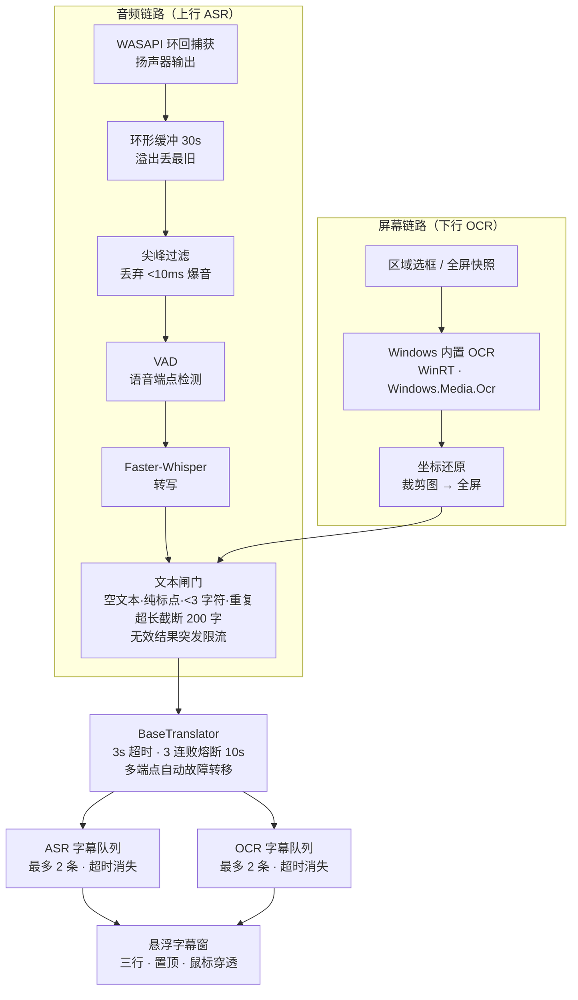

# SubMirror

[]()
[](LICENSE)
[]()

**游戏与视频的实时中英互译悬浮字幕。** 通过 Windows 原生 WASAPI 环回捕获扬声器输出做语音识别，
配合屏幕区域 OCR 识别画面文字，将结果实时翻译成悬浮字幕显示在屏幕底部。

> 本项目不注入游戏进程、不读写游戏内存、不挂钩任何 API、不模拟键鼠输入、不安装驱动或服务。
> 仅使用 Windows 公开的用户态 API。**但请仍然阅读 [安全声明](#安全声明-必读) 与 [PRIVACY.md](PRIVACY.md)。**

> **版本口径**：**v0.1.7（2026-10-16）是已冻结的正式开源发布基线**，本仓库当前源码为 **v0.1.19 开发版**
> （在其之上补齐系统托盘、固定区域 OCR、ASR 流式优化、两处行为修复、ASR 设置页悬浮提示、FPS 俚语词典与
> 增量预览翻译、悬浮窗样式面板与性能四项、切片按句翻译与翻译上下文、过载自适应与开机自启、三种工作模式与采集来源/混音，
> 0.1.7 的发布产物与哈希不受影响）。验收项 ✅ 62 / ⏳ 0 / ⏸ 2（共 64），
> 四轮无头运行时验收全部通过。BL-6（关于页外链、环回设备下拉）**不在 v0.1.7 发布范围**，计划在后续版本迭代；
> 安装包编译与三项人工复验需在无 Application Control 策略的 Windows 目标机执行，清单见
> [发布清单](#v0119-发布清单未完成项在目标机执行)。

---

## 目录

- [安全声明（必读）](#安全声明必读)
- [功能特性](#功能特性)
- [系统要求](#系统要求)
- [快速开始（源码运行）](#快速开始源码运行)
- [语音模型准备](#语音模型准备)
- [打包与分发](#打包与分发)
- [热键与操作](#热键与操作)
- [配置文件](#配置文件)
- [工作流程](#工作流程)
- [稳定性设计](#稳定性设计)
- [项目结构](#项目结构)
- [常见问题](#常见问题)
- [已知限制](#已知限制)
- [分阶段交付说明（v0.1 基线）](#分阶段交付说明v01-基线)
- [v0.2 规划](#v02-规划)
- [开发约定](#开发约定)
- [许可](#许可)
- 工程文档：[变更记录](CHANGELOG.md) · [迭代待办工单](ITERATION_BACKLOG.md) · [整机验收清单](ACCEPTANCE.md)

---

## 安全声明（必读）

**这一点比其他任何功能都重要：使用任何第三方覆盖层工具都存在被反作弊系统误判的极低概率。**

SubMirror 在设计上刻意把风险降到最低：

| 不做的事 | 说明 |
|---|---|
| ❌ 进程注入 | 不调用 `OpenProcess`/`WriteProcessMemory`，不对任何游戏进程做任何操作 |
| ❌ 内存读取 | 不读取任何进程内存 |
| ❌ API 挂钩 | 不安装全局钩子（无 `SetWindowsHookEx` 键盘钩子）、不做 API Hook |
| ❌ 驱动与服务 | 不安装内核驱动，不注册系统服务，无 `SYSTEM` 权限需求 |
| ❌ 键鼠模拟 | 不发送任何模拟输入（无 `SendInput`/`keybd_event`） |
| ❌ 进程隐藏 | 不隐藏进程、不加壳、不绕过反作弊 |
| ❌ 游戏文件修改 | 不触碰游戏目录、不修改任何游戏文件 |

**实际使用的技术，全部是普通桌面程序的公开 API：**

- **音频**：WASAPI Loopback（系统混音环回）——只"听"扬声器正在播放的内容，不劫持、不独占音频设备，与 OBS/录屏软件的采集方式同源。
- **屏幕**：普通桌面截图 API（BitBlt / mss / Qt 截屏），**不使用 DXGI 桌面复制钩子**。
- **识别**：Faster-Whisper 离线语音识别 + **Windows 内置 OCR（WinRT，`Windows.Media.Ocr`）** 文字识别，均在本地运行，不需要下载任何 OCR 模型。
- **字幕窗口**：标准 Windows 透明置顶窗口（Qt），**不是 DLL 注入式 Overlay**。
- **全局热键**：优先使用 Windows 原生 `RegisterHotKey`，轻量轮询捕获 `KEYUP`。**不使用 `pynput` 全局钩子作为主方案。**

**风险自负**：即使遵循上述设计，任何在游戏之上绘制窗口或读取屏幕/音频的工具，理论上都可能被行为检测误判。
请自行评估游戏的服务条款。竞技类游戏、比赛环境、有严格第三方软件政策的游戏，请谨慎使用或不要使用。

---

## 功能特性

### 实时语音字幕（上行）

- WASAPI 环回捕获扬声器输出，**从不申请麦克风**——避免把 TTS 朗读回录形成自激回声。
- 三级后端自动降级：`PyAudioWPatch` → `soundcard` → 空后端（合成静音，程序不崩溃）。
- 音频链路：环形缓冲（默认 30 秒，溢出丢弃最旧）→ **尖峰噪声过滤（丢弃 < 10ms 的爆音）** → VAD 语音端点检测 → Faster-Whisper 转写 → 文本清洗 → 在线翻译。
- **Silero VAD（0.1.14）**：默认用 `onnxruntime` 跑内置 `silero_vad.onnx` 做人声检测，比能量门限更稳；
  模型缺失或推理异常时自动退回内置能量门限，**不引入 torch、运行时不下载**。
- **低延迟流式（0.1.14）**：滑窗分片缩到 6 秒 + 200 ms 重叠，识别边说话边出**预览字幕**（最终结果就地替换该行），
  翻译走独立泳道并**回填原行**，用于缓解 5–6 秒的端到端滞后。
- **单机模式**：默认灵敏度，完整识别连续语音。
- **FPS 安全模式**：`min_speech_duration_ms = 200`，过滤枪声与脚步等短促噪声。
- **设置页悬浮提示（0.1.16）**：ASR 页的「模型规格」下拉为每个型号（跟随模型路径 / `tiny` / `base` / `small` /
  `medium`）提供**鼠标悬浮提示**，说明体积、速度、精度与适用场景；只读的「人声检测」状态行同样带提示，
  逐条解释 `auto` / `silero VAD` / `energy VAD` 的行为与取舍。提示是**纯 UI 文案**，不改变任何识别逻辑。
- **FPS 俚语词典（0.1.17）**：内置 46 条 FPS 常用口语/缩写（`gg` `wp` `clutch` `ace` `ez` `noob` `save` `eco`
  `ff` `afk` `u` `r` `nah` `on me` `behind you` `1v1` …），在翻译**之前**做整词替换（词边界匹配，`u` 不会命中
  `you`），减少离谱直译；纯俚语短句（`gg`、`wp`）不再被最小长度过滤拦掉。可在 `config.json` 里关掉
  （`text.slang_enabled`）或换词表（`text.slang_path`）。
- **乱码/幻觉过滤（0.1.17）**：过滤 Whisper 常见的 `thank you` / `thanks for watching` / `please subscribe` /
  `subtitles by` 一类幻觉、`[Music]`/`（掌声）` 标签、符号堆（`♪♪♪`）与重复字符（`yeah yeah yeah yeah`、
  `aaaaaaaa`）；被过滤的文本**不送翻译、不上屏**，真实短回应（`ok`/`no`/`nice`）不受影响（`text.asr_noise_filter`）。
- **增量预览先翻译（0.1.17）**：预览字幕不再直接显示**英文原文**，而是等翻译回来才渲染（失败才回退原文），
  最终成片段复用同一行收尾，避免"先闪原文再补译文"（`asr.preview_translate`）。
- **性能优化（0.1.17）**：ASR 等工作队列有**硬上限**（默认 audio 1 / vad 4 / asr 1 / ocr 1 / translate 8），
  队列满时**丢弃最旧的未处理项**并上报，提交永不阻塞；energy VAD 分片加长到 **9 秒**（Silero 仍 6 秒），
  13 秒连续语音的识别任务数由 2 降到 1；悬浮字幕**最大刷新帧率默认 30 fps**、**全屏游戏时自动降速**到一半、
  无变化的动画帧不重绘；UI 线程与识别/OCR 工作线程分离，调度器 `stats()` 不再持全局锁读计数；
  日志**默认只输出警告/错误**，可在设置 → 高级 →「日志」里改为 `info`/`debug`（保存即生效，不写日志文件）。

### 屏幕 OCR 字幕（下行）

- **区域 OCR**：按住热键拖拽框选，**持续流式识别**；松开热键立即停止并清空该行字幕。
- **全屏 OCR**：按下热键对显示器做**一次性快照识别**，只识别一次。
- 两个热键互相独立、可自定义；保存配置时校验重复，冲突会弹窗提示（弹窗文字跟随界面语言）。
- **固定区域 OCR（0.1.13，拾取流程 0.1.15 修订）**：在设置面板**画框保存坐标**后，用快捷键
  **一键启停**持续识别该固定区域；画框时**松开左键即保存坐标、按 Esc 才结束**拾取（0.1.15 起遮罩不再自动销毁）；
  画面与文本**两道变化门**（无变化就跳过 OCR 与翻译），关闭即停止并清空该行字幕。
- 各路 OCR 结果输出到悬浮窗的**下行 OCR 字幕行**，与上行 ASR 字幕完全独立、互不干扰。
- FPS 安全模式下区域 OCR 上限 **0.5 fps**、普通模式 **5.0 fps**；全屏 OCR 最小触发间隔 **800 ms**。
- v0.1 全屏 OCR **仅支持主显示器**（多显示器支持在 v0.2）。

### 悬浮字幕窗

- 三行布局：**上行 ASR 字幕**（常驻）/ **中行 TTS 字幕**（v0.1 默认隐藏，仅占位）/ **下行 OCR 字幕**（识别时显示）。
- 可调字号、字幕不透明度、遮罩不透明度；字幕超长自动截断到 200 字符。
- **置顶模式**：鼠标穿透 + 永远顶层，不抢游戏焦点、不遮挡操作。
- **非置顶模式**：可自由拖拽移动，位置自动记忆。
- 右上状态指示器：🟢 音频正常 / 🟡 处理中 / 🔴 异常，异常时悬浮窗提示原因。
- **淡入淡出过场（0.1.14）**：每条字幕按通道独立 alpha 渐显 + 轻微上移，消失前先淡出（QQ 音乐式）；
  时长与位移可调，两个时长同时为 0 即回到无动画的即时显隐。
- 【显示原始英文】选项：同时显示原文与译文；翻译失败时保留原文。
- **样式面板（0.1.17）**：预设下拉（默认圆角长方形 900×220 / 紧凑窄长矩形 660×120 / 正方形 600×600）一键套用，
  宽度 / 高度 / **字幕文字大小** / **圆角半径**（0 = 直角）/ **面板背景透明度**（0 = 全透明、100 = 全不透明）
  全部改为**滑块 + 精确数字框**双向同步，另有【文字随面板缩放】开关（按面板宽度等比缩放字号）。
- **三项增强（0.1.17）**：**字幕动画时长**滑块 0–800 ms（0 = 关动画）、**文字颜色 + 描边粗细**（0–8 px，
  0 = 无描边）、**窗口锁定**开关（开启后无法拖拽移动，防止误拖）。

### 三种工作模式与采集来源（0.1.19）

- **工作模式下拉**：设置 → 常规的「工作模式」提供 **全能 / 游戏 / 对话** 三档，**选中即载入该档推荐参数**
  并立即生效（不必等「保存」），单行数值仍可手改；`app.mode_auto_params`（默认开）控制启动时是否重新套用推荐值。
  - **全能模式**：标准参数——切片 2.0 s、VAD 引擎自动、扬声器来源、队列 3、30 FPS。
  - **游戏模式**：VAD 门限 −45 → **−35 dB**、最短语音 300 → **450 ms**、切片 2.5 s（上限 5.0 s）、
    开启**爆破音过滤**（≤60 ms、高于运行中位数 +10 dB 且被前后静音包夹的短促尖峰静音，枪声不触发识别）、
    关闭静音补帧、队列 2、刷新率 30 → **15 FPS**、区域 OCR 5 → 1 FPS（降低 CPU、保护帧率）。
  - **对话模式**：来源切为**麦克风 + 扬声器混合**，麦克风权重 1.0、扬声器 **0.35**（突出人声、压低游戏声），
    开启**背景降噪**（−12 dB 自适应噪声门）、门限 −48 dB、束宽 1 → **5**（通话优先准确度），
    适合 Talking 通话与视频会议。
- **采集来源**：`audio.source` = `speaker`（系统声音，默认）/ `microphone`（默认输入设备）/
  `mixed`（两路加权相加，权重 `audio.mic_gain`、`audio.speaker_gain`，各 0–4）。麦克风可用
  `audio.mic_device` 指定序号或名称片段，留空跟随系统默认；混音时某一路超过 `audio.mix_grace_ms`
  （400 ms）没有新音频即自动旁路，恢复后自动并入。
- **本机 DSP**：`audio.noise_suppression`（默认关）以「一阶高通 + 自适应噪声门」按
  `audio.noise_reduction_db`（默认 12 dB）压制底噪；`audio.burst_filter`（默认关，游戏模式开）静音
  「高于运行中位数 `audio.burst_margin_db`、短于 `audio.burst_max_ms` 且有前后静音包夹」的片段。
  两级只作用于麦克风/混合来源，且全部在本机完成、不外发。
- **队列背压**：`perf.asr_queue_max` 4 → **3**、`perf.translate_queue_max` 4 → **3**、
  `translate.task_timeout_ms` 700 → **600 ms**；新增 `perf.pause_capture_on_full`（默认开）——
  ASR 队列积压到上限时**暂停音频采集**（宁可丢一小段，也不让延迟无限增长），队列腾空自动恢复，
  字幕提示「队列已满，已暂停采集」。
- **字幕刷新**：`perf.overlay_min_interval_ms` 400 → **500 ms**（内容重绘地板；动画 tick 仍独立，
  渲染始终在 GUI 线程，识别与翻译始终在 worker 线程）。

### 切片按句翻译与过载自适应（0.1.18）

- **切片与静音**：默认 **2.0 s** 强制切片（上限 4.0 s，超时/积压时按 +0.5 s / −0.25 s 步进自适应拉长与回落）、
  强制切片回放 **400 ms** 尾音（避免切断单词）、静音切片被标记后**整段丢弃**（不送识别）。
- **按句翻译与上下文**：识别结果按 `.!?` 切句（`asr.sentence_split`），每句一条字幕行、一个翻译任务，
  单次最多 `asr.max_sentences` 句；翻译附带最近 `translate.context_sentences`（默认 2）句上文，
  上限 `translate.context_max_chars`（240 字）——**只有声明 `supports_prompt` 的后端才会收到**（内置免密端点不会）。
- **语气词与幻觉**：`text.filler_filter` 整词剥离 `um`/`uh`/`ah`/`hmm` 等填充词（词边界匹配，`ha` 不误伤 `hard`），
  只剩语气词的切片不上屏、不翻译，与 0.1.17 的 `text.asr_noise_filter` 叠加生效。
- **调度与超时**：`perf.asr_queue_max` 1 → **4**、`perf.translate_queue_max` 8 → **4**、
  `perf.translate_workers` 默认 **1**（翻译单并发）、`translate.task_timeout_ms` 默认 **700 ms** 单任务截止；
  队列满丢最旧并写 warning 日志；持续超时/积压自动拉长切片（`TaskScheduler.pending_count()` 提供过载反馈）。
- **字幕刷新与友好提示**：`perf.overlay_min_interval_ms` 默认 **400 ms** 作为**内容重绘**地板
  （动画 tick 仍是 33 ms / 全屏 67 ms，二者分离，避免 180 ms 淡入被量化）；翻译超时 / 服务失败 / 音频积压
  分别显示「翻译超时」「翻译服务繁忙」「音频积压，已跳过一段」，字幕不会空白。
- **开机自启**：`app.autostart` 默认关闭（设置 → 高级可开关），与 LibreTranslate 自启**共用同一个**
  启动项文件且 app 自启优先；未配置（或无效）LibreTranslate 目录时只静默启动 SubMirror 本体。
- **线程边界**：ASR、翻译、网络请求全部在 worker 线程，UI 主线程只做渲染（避免游戏掉帧）。

### 性能与日志（0.1.17）

- **有界工作队列**：audio / vad / asr / ocr / translate 五条泳道各有硬上限（`perf.*_queue_max`，
  默认 1/4/1/1/8）；队列满时**丢弃最旧的未处理项**并通过 `task_dropped` 上报，`submit()` 永不阻塞调用方，
  防止任务堆积导致时间戳跳变。
- **energy VAD 分片加长**：`audio.vad_energy_max_segment_seconds` 默认 **9.0 s**（能量门控无语音模型，
  可以用更长的片）；Silero 生效时仍用 `audio.vad_max_segment_seconds`（6.0 s）。
- **字幕刷新预算**：`perf.overlay_max_fps` 默认 **30**（间隔下限 4 ms）；`perf.overlay_fullscreen_slowdown`
  开启时，检测到前台是全屏窗口就把动画间隔加倍（`perf.overlay_fullscreen_scale` 默认 0.5）；
  动画状态未变化的帧直接跳过重绘；worker 线程的 `refresh()` 在动画进行中按帧间隔合并。
- **线程与锁**：识别 / OCR / 翻译全部跑在调度器工作线程上，UI 线程只做渲染；`TaskScheduler.stats()`
  先取泳道快照、再在锁外读计数，避免 UI 诊断轮询与提交争抢全局锁。
- **日志分级**：`logging.level` 默认 `warning`（只出警告/错误，减少调试日志持续写盘），可选
  `debug`/`info`/`warning`/`error`，设置 → **高级** →「日志」页修改，保存即生效。**全项目不安装 FileHandler**
  （唯一写盘的是启动器 `silent_launch.py` 自己的 LibreTranslate 日志）。

### 翻译

- 抽象基类 `BaseTranslator` + 在线实现 `OnlineTranslator`，**不绑定任何单一翻译服务**。
- 免密钥公共端点，自动故障转移：`google-gtx` → `mymemory` → `libretranslate`。
  失败端点自动轮转到队尾，成功端点粘性优先，避免每次都被失效端点拖满超时。
- 超时 **3 秒**；**连续 3 次失败触发 10 秒熔断**，期间悬浮窗提示"翻译服务不可用"，到期自动恢复。
- 翻译语种与界面语言完全独立（可以中文界面 + 翻译成英文）。

### 语音识别流式优化与 Silero VAD（0.1.14）

- **接入 Silero VAD 人声检测**：`src/audio/silero_vad.py` 用 `onnxruntime` 直接跑
  `models\silero_vad.onnx`（512 样本/帧 + 64 样本上下文，与官方参考实现一致），
  **不引入 torch、运行时不下载任何模型**。模型缺失或推理失败会自动退回内置能量门限
  （`audio.vad_engine` = `auto` / `silero` / `energy`），永不因 VAD 崩掉。
- **滑窗分片更小**：`audio.vad_max_segment_seconds` 默认 `15.0` → **`6.0`**、
  `audio.vad_hangover_ms` `400` → **`320`**，切段时保留 `audio.vad_overlap_ms`（默认 200 ms）尾部重叠，
  避免把单词切断。这是缓解「说话到出字幕滞后 5–6 秒」的主要改动。
- **强制英文 + 解码调优**：`asr.force_english`（默认开）锁定英文识别；`asr.beam_size` `5` → **`1`**，
  并新增 `asr.best_of` / `asr.temperature` / `asr.no_speech_threshold` / `asr.compression_ratio_threshold` /
  `asr.log_prob_threshold` / `asr.initial_prompt` 等 faster-whisper 解码参数（默认贪心 + 关闭时间戳与上文条件）。
- **增量输出**：`asr.streaming`（默认开）在讲话过程中按 `asr.partial_interval_ms`（1100 ms）先出**预览字幕**，
  最终分段结果**替换同一行**，不会出现预览行与最终行并排。
- **翻译时间对齐**：`asr.translate_in_lane`（默认开）把翻译移到独立泳道，
  迟到的译文通过就地更新**回填到原字幕行**（`SubtitleQueue.update`），不再另起一行。
- **设置页模型下拉**：ASR 页新增模型型号下拉（`asr.model_size`：跟随模型路径 / tiny / base / small / medium），
  以及只读的「VAD 引擎」状态行（显示当前生效引擎或降级原因）。

### 字幕淡入淡出（0.1.14）

- QQ 音乐式过场：每条字幕按通道独立做 **alpha 渐显 + 轻微垂直位移**，删除前先淡出。
- 由 `subtitle.fade_in_ms`（180）、`subtitle.fade_out_ms`（220）、`subtitle.fade_slide_px`（6）控制；
  `fade_in_ms` 与 `fade_out_ms` **同时为 0 即完全退化为原来的即时显隐**（零动画路径，行为不变）。

### 固定区域持续 OCR（0.1.13）

- 设置 → **OCR** 页新增「固定区域」行：**画框选取**（复用全屏遮罩拖拽）、只读坐标显示、
  **启用**开关与**变化灵敏度**。坐标存进 `config.json` 的 `ocr.fixed_region`（`"x,y,w,h"`），
  下次启动仍然有效；点画框后**取消**不会改动原值。
- **拾取流程（0.1.15 起）**：按 **Alt+C**（`hotkeys.toggle_region_ocr` 默认值，可自定义）唤起全屏遮罩，
  **松开左键立即保存**该矩形坐标（面板显示「区域已保存」），遮罩**继续留在屏幕上**让人核对结果，
  按 **Esc**（或右键 / Backspace）才结束本次拾取并收起遮罩；热键松开**不再**清空已保存的选区。
- **一键启停**：快捷键 `hotkeys.toggle_region_ocr`（出厂默认 `Alt+C`，可自定义或清空为不绑定）。
  启用后按 60 ms 节奏循环截取该区域，关闭立即停止并清空该行字幕。
- **保存校验按 ASR 开关短路（0.1.15 起）**：只有**语音识别处于启用状态**时，「保存」才会校验
  `asr.model_path` 指向的 Whisper 模型目录；ASR 关闭时该目录**完全不校验**，路径为空或失效都不再弹框。
- **两道变化门**避免静止画面反复 OCR / 反复翻译：①16×16 亮度指纹，容差
  `ocr.region_change_tolerance`（默认 `8`，且需 ≥4 格越界）；②文本规范化（去空白、统一大小写、
  去标点）后比对，相同不提交。
- 与既有「拖拽选区 OCR」共用同一个定时器与截图后端，**不新开线程**、不改 ASR 与翻译核心。

### 内置模型自动识别（0.1.12）

- 便携包里与 `SubMirror.exe` 同级的 `models\faster-whisper-base` 现在会被**自动采用**：
  `asr.model_path` 为空、或指向已被删除／搬走的旧目录时，程序不再提示「未配置模型」，
  而是直接使用包内模型。
- **校验逻辑一字未改**：自动找到的目录仍要满足与手选目录完全相同的检查
  （`model.bin` + `config.json` 平铺等），不合法时给出的仍是原来的
  `model-path-empty` / `model-path-missing`。
- 手动选择的模型目录若有效，仍然**优先**于内置模型；设置面板与
  `start_submirror.bat` 的行为不变。

### 登录静默启动 LibreTranslate（0.1.11）

- 设置 → **翻译**页新增两项：**「LibreTranslate 目录」**（指向含 `start_libretranslate.bat` 的目录，
  留空时自动探测常见位置）与**「登录时静默启动 LibreTranslate（无窗口）」**复选框。
- 勾选后向**当前用户的「启动」文件夹**写入 `SubMirror-SilentStart.vbs`：登录时以**无黑窗**方式
  拉起 LibreTranslate 服务，轮询到端点真正能翻译之后，才启动 SubMirror 主程序。
- 服务在超时内没有就绪就**不启动主程序**，并把原因写进 `%APPDATA%\SubMirror\silent_start.log`。
- 取消勾选会**删除该启动项**，并顺带清理可能残留的同名计划任务（`SubMirror-SilentStart` /
  `SubMirror-LibreTranslate`）。**全程不需要管理员权限、不触发 UAC。**
- 端口取自翻译页的**「服务地址」**（默认 `http://127.0.0.1:5000`）。

### 通用

- **双语言界面**：简体中文 / English，设置面板下拉**实时切换，无需重启**。
- 全局热键自定义、单实例互斥体（重复打开会激活已有窗口，不重复启动）。
- **ASR 随时启停**：可录一个全局热键在运行中暂停 / 恢复语音识别（暂停即释放音频设备），
  出厂默认不绑定按键。
- `config.json` 损坏或非法值自动重置为默认并弹窗告知，绝不闪退，所有数值项均有范围校验。
- 设置面板提供**一键重置音频/OCR 后台任务**，无需重启程序。
- 首次启动显示免责声明，**勾选同意后**才加载悬浮窗与设置面板。

---

## 系统要求

| 项目 | 要求 |
|---|---|
| 操作系统 | Windows 10 / 11（64 位） |
| 权限 | **普通用户权限即可，无需管理员** |
| 网络 | 仅翻译功能需要联网；语音与 OCR 识别全部本地运行 |
| 源码运行 | Python 3.10 – 3.12（推荐 3.11） |
| 可选硬件 | NVIDIA GPU（可用 CUDA 加速 Whisper；纯 CPU 亦可运行） |

> ⚠️ **构建路径请使用纯 ASCII 路径**（例如 `D:\dev\SubMirror`）。PyInstaller 与 ctranslate2 运行时在含中文或空格的路径下存在历史问题。

---

## 快速开始（源码运行）

```bat
:: 1. 获取源码
git clone <repository-url> SubMirror
cd SubMirror

:: 2. 创建虚拟环境（必须从仓库根目录运行程序）
python -m venv .venv
.venv\Scripts\activate

:: 3. 安装依赖
python -m pip install --upgrade pip
python -m pip install -r requirements.txt

:: 4. 启动
python main.py
```

首次启动会依次出现：免责声明窗口 → 字幕悬浮窗。

> **便携版**（`SubMirror-0.1.19-portable.zip`）已内置 Faster-Whisper **base** 模型
> （`models\faster-whisper-base`，就在 `SubMirror.exe` 旁边）与 **Silero VAD** 模型
> （`models\silero_vad.onnx`），**程序会自动识别并使用它们**
> （0.1.12 起：`asr.model_path` 为空、或指向已失效的旧目录都不再报「未配置模型」），
> 附带的 `start_submirror.bat` 仍会把内置模型写进用户配置再启动程序，两条路径都可用，
> 因此**不会再出现「请选择 Whisper 模型目录」的提示**；
> 若用 ASR 启停热键把语音识别**暂停**，该提示同样不会再出现（0.1.10 起）。
> 源码运行方式仍需按下一节自行准备模型目录。

> **必须从仓库根目录运行。** 本项目使用隐式命名空间包（**没有 `__init__.py`**），
> 所有内部导入形如 `from src.core.config import ...`，依赖当前工作目录在 `sys.path` 中。

`requirements.txt` 分三层：核心必需、Windows OCR 支持、可选增强项。
v0.1 只使用 **Windows 内置 OCR**：不需要 `paddleocr` / `rapidocr-onnxruntime` 之类的第三方引擎。
请确认系统已安装对应语言的 OCR 语言包（**设置 → 时间和语言 → 语言 → 可选功能**）；
语言包缺失时程序不会崩溃，只会禁用 OCR 字幕行，音频字幕不受影响。

---

## 语音模型准备

**便携版内置模型**（0.1.9 起）：`Systran/faster-whisper-base`（约 141 MB，CTranslate2 格式）
随包分发，位于 `models\faster-whisper-base\`，由包内 `start_submirror.bat` 自动写入配置，
开箱即用。

**源码运行**：模型不随源码分发（体积数百 MB，且各自有独立许可证）。请在
[Hugging Face](https://huggingface.co/Systran) 下载 CTranslate2 格式的 Faster-Whisper 模型，
然后在**设置面板 → 音频 / ASR → 模型目录**中指定。

推荐模型（按体积/质量权衡）：

| 模型 | 体积 | 适用场景 |
|---|---|---|
| `faster-whisper-base`（**便携版已内置**） | ~141 MB | 开箱即用，质量一般但延迟最低 |
| `faster-whisper-small` | ~480 MB | 低配机器、追求低延迟 |
| `faster-whisper-medium` | ~1.5 GB | 推荐起点，中英识别质量与延迟平衡 |
| `faster-whisper-large-v3` | ~3.1 GB | 追求最高识别质量，需要较好显卡 |

**模型目录必须包含**（缺一会弹窗提示）：

```text
<模型目录>\
├── config.json
├── model.bin
├── tokenizer.json
└── vocabulary.txt
```

设置面板选择目录时**会预先校验**文件夹与模型文件是否齐全，缺失时立即弹窗，不会等到运行时才失败。
程序也支持 Hugging Face 缓存中已下载的模型（`snapshots/` 嵌套布局）。

---

## 打包与分发

两个脚本都没有额外依赖要求（打包脚本用系统自带 PowerShell 压缩，不需要 7-Zip）。

### 便携版

```bat
build_portable.bat                          :: 构建 + 压缩
build_portable.bat /NOZIP                   :: 只构建不压缩
build_portable.bat /CONSOLE                 :: 保留控制台窗口（调试用）
build_portable.bat /KEEPBUILD               :: 复用上次的 build\pyinstaller 缓存
build_portable.bat /PYTHON "C:\Python311\python.exe"
```

可选：把语音模型与启动脚本一起打进便携包（两个环境变量都**不设置时不打包**，
仓库文件清单因此保持不变）：

```bat
set SUBMIRROR_PORTABLE_MODEL=D:\models\faster-whisper-base   :: → models\faster-whisper-base
set SUBMIRROR_PORTABLE_EXTRAS=D:\portable-extras             :: → 复制到包根目录
build_portable.bat
```

产物：

```text
dist\SubMirror-portable\SubMirror.exe       ← 整个文件夹一起复制，单独拷贝 exe 无法运行
dist\SubMirror-portable\start_submirror.bat ← 首次启动：写模型路径 + 启动程序（内置模型时才有）
dist\SubMirror-portable\models\faster-whisper-base\
dist\SubMirror-portable\models\silero_vad.onnx
dist\SubMirror-0.1.19-portable.zip
```

脚本会检查依赖、打印逐项 OK/missing 报告、从源码自动读取版本号，并只清理它自己产生的
三个目录（`build\pyinstaller`、`dist\SubMirror`、`dist\SubMirror-portable`）。

### 安装包

```bat
makensis build_installer.nsi
makensis /DDIST_DIR="dist\SubMirror" /DAPP_VERSION="0.1.19" build_installer.nsi
```

产物：`SubMirror-0.1.19-setup.exe`

- **按用户安装**（`%LOCALAPPDATA%\SubMirror`），**不触发 UAC、不需要管理员权限**。
- 安装向导支持 **简体中文 / English** 双语，含 MIT 许可证页面。
- 组件可选：核心程序（必需）、开始菜单快捷方式、桌面快捷方式。
- 安装/卸载时会检测程序是否正在运行（通过程序自建的单实例互斥体），请先退出再继续。
- **卸载默认保留 `%APPDATA%\SubMirror\config.json`**，会在删除前单独询问，不会静默清掉你的热键与模型路径配置。

> 安装包**未做代码签名**，Windows SmartScreen 可能提示"未知发布者"，选择"更多信息 → 仍要运行"即可。

---

## 热键与操作

### 默认热键

| 功能 | 默认热键 | 行为 |
|---|---|---|
| 区域 OCR | `Ctrl + Alt + A` | **按住**拖拽框选 → 持续流式识别；**松开**停止并清空 OCR 字幕 |
| 全屏 OCR | `Ctrl + Alt + S` | **按下**对主显示器一次性快照识别，只识别一次 |
| 固定区域 OCR 启停 | `Alt + C` | **按下**启动 / 停止持续识别设置面板里画好的固定区域；也是**画框拾取的唤起键** |
| ASR 启停 | *（默认不绑定）* | **按下**在「暂停语音识别」与「恢复」之间切换；暂停会释放音频设备 |

热键可在设置面板中自定义。**ASR 启停**热键**出厂为空**（不占用任何键位），
需要时在设置面板里按下想用的组合键即可录制；**固定区域 OCR 启停出厂为 `Alt+C`**（0.1.15 起），
也可清空为不绑定，使用前需要先在 OCR 页**画框保存坐标**——按 `Alt+C` 唤起遮罩，
**松开左键即保存坐标、按 Esc 结束拾取**（遮罩不会自动销毁）。
保存时若四个热键中有任意两个相同会弹窗提示更换，且**配置不会写入**（弹窗语言跟随界面语言）。

### 悬浮窗操作

| 操作 | 效果 |
|---|---|
| 左键拖动 | 移动悬浮窗（仅非穿透模式），位置自动保存 |
| 双击 | 切换鼠标穿透模式 |
| `Esc` | 隐藏字幕窗口 |
| 托盘图标左键单击 | 显示 / 隐藏悬浮窗 |
| 托盘图标右键 | 菜单：显示 / 隐藏悬浮窗、打开设置、重置悬浮窗、暂停 / 启用 OCR、关于、退出 |

若悬浮窗被拖到屏幕外或看不见了：托盘图标右键 → **重置悬浮窗**。

---

## 配置文件

配置文件位置（按用户安装/源码运行）：

```text
%APPDATA%\SubMirror\config.json
```

便携模式例外：当源码中 `PORTABLE_MODE_ENABLED = True` 且程序目录存在 `SubMirror.portable` 标记文件时，
配置改存放在程序目录旁。`build_portable.bat` 只在检测到该开关为 `True` 时才写入标记文件。

**配置损坏或数值非法时自动重置为默认值并弹窗告知**，不会闪退；无法识别的额外键会被保留（向前兼容）。

主要配置项：

| 配置键 | 默认值 | 说明 |
|---|---|---|
| `ui_language` | `zh-CN` | 界面语言（`zh-CN` / `en`），实时生效 |
| `disclaimer_accepted` | `false` | 是否已同意免责声明 |
| `fps_safe_mode` | `false` | FPS 安全模式（更激进的噪声过滤 + OCR 降频） |
| `hotkeys.area_ocr` | `Ctrl+Alt+A` | 区域 OCR 热键 |
| `hotkeys.fullscreen_ocr` | `Ctrl+Alt+S` | 全屏 OCR 热键 |
| `hotkeys.toggle_asr` | `""`（不绑定） | ASR 启停热键，在设置面板录制后才生效 |
| `hotkeys.toggle_region_ocr` | `"Alt+C"` | 固定区域 OCR 启停热键（0.1.15 起出厂默认 `Alt+C`；清空即不绑定），在设置面板可改 |
| `audio.sample_rate` | `16000` | 识别采样率（采集跟随设备原生采样率，此处为识别率） |
| `audio.ring_buffer_seconds` | `30` | 环形缓冲时长，溢出丢弃最旧音频 |
| `audio.spike_filter_ms` | `10` | 尖峰噪声过滤阈值（短于此长度的爆音被丢弃） |
| `audio.silence_log_seconds` | `30` | 长时间静音后的控制台提示间隔 |
| `audio.vad_engine` | `auto` | 人声检测引擎：`auto`（有模型用 Silero，否则能量门限）/ `silero` / `energy` |
| `audio.vad_silero_path` | `""` | Silero ONNX 模型路径（空 = 自动查找 `models\silero_vad.onnx`） |
| `audio.vad_silero_threshold` | `0.5` | Silero 语音概率门限（0–1，越高越保守） |
| `audio.vad_silero_negative_margin` | `0.15` | Silero 滞回下限（低于 `门限-该值` 才判定语音结束） |
| `audio.vad_silero_min_speech_ms` | `250` | Silero 判定下的最短语音片长（毫秒） |
| `audio.vad_hangover_ms` | `320` | 能量门限的拖尾判定（0.1.14 由 400 收紧） |
| `audio.vad_max_segment_seconds` | `6.0` | 单段最长音频（0.1.14 由 15.0 收紧，缩短输出滞后） |
| `audio.vad_overlap_ms` | `400` | 强制切段时保留的尾部重叠（0.1.18 由 200 上调；仅强制切片回放尾音） |
| `audio.vad_chunk_seconds` | `2.0` | 强制切片目标长度（1.0–10.0 s；0.1.18 新增，语音持续时按此切段） |
| `audio.vad_chunk_max_seconds` | `4.0` | 强制切片自适应上限（持续过载/超时逐步拉长，恢复后逐步回落） |
| `audio.source` | `speaker` | 采集来源：`speaker` 系统声音 / `microphone` 麦克风 / `mixed` 混合（0.1.19） |
| `audio.mic_device` | `""` | 麦克风设备序号或名称片段，留空跟随系统默认（0.1.19） |
| `audio.mic_gain` | `1.0` | 混音时麦克风权重（0–4；0.1.19） |
| `audio.speaker_gain` | `1.0` | 混音时扬声器（环回）权重（0–4；对话模式 0.35；0.1.19） |
| `audio.mix_grace_ms` | `400` | 某一路超过该时长无新音频即旁路（50–5000 ms；0.1.19） |
| `audio.noise_suppression` | `false` | 背景降噪（仅麦克风/混合来源；0.1.19） |
| `audio.noise_reduction_db` | `12.0` | 降噪强度（0–30 dB；0.1.19） |
| `audio.noise_floor_adapt_s` | `1.0` | 噪声底估计使用的历史时长（0.2–5.0 s；0.1.19） |
| `audio.burst_filter` | `false` | 爆破音（枪声）过滤（仅麦克风/混合来源；游戏模式开；0.1.19） |
| `audio.burst_max_ms` | `60.0` | 判定为爆破音的最长时长（10–200 ms；0.1.19） |
| `audio.burst_margin_db` | `10.0` | 爆破音判定余量（3–30 dB；0.1.19） |
| `asr.model_path` | `""` | Whisper 模型目录（**必填**，否则语音字幕不可用） |
| `asr.model_size` | `""` | 模型型号下拉：`""`(跟随模型路径) / `tiny` / `base` / `small` / `medium`（0.1.14） |
| `asr.language` | `auto` | 识别语种（`asr.force_english` 为 `true` 时被覆盖为英文） |
| `asr.force_english` | `true` | 强制按英文识别（0.1.14；改回 `false` 恢复语种自动判定） |
| `asr.vad_mode` | `single` | `single` 单机模式 / `fps` FPS 安全模式 |
| `asr.beam_size` | `1` | 解码束宽（0.1.14 由 5 降到 1，优先低延迟） |
| `asr.streaming` | `true` | 讲话期间增量预览识别（0.1.14） |
| `asr.partial_interval_ms` | `1100` | 预览识别间隔（毫秒） |
| `asr.partial_min_seconds` | `0.6` | 发起预览识别的最小已累积音频 |
| `asr.partial_max_seconds` | `8.0` | 预览识别使用的音频上限（超过按此截取） |
| `asr.translate_in_lane` | `true` | 翻译走独立泳道并把迟到译文回填原字幕行（0.1.14） |
| `asr.preview_translate` | `true` | 增量预览先翻译再上屏，禁止未翻译原文直接显示（0.1.17；关掉则恢复 0.1.14 的"先原文后译文"） |
| `asr.best_of` | `1` | 采样解码候选数（贪心解码下无效） |
| `asr.temperature` | `0.0` | 解码温度（0 = 贪心） |
| `asr.condition_on_previous_text` | `false` | 是否用上文做条件（关闭以降低延迟与幻觉） |
| `asr.without_timestamps` | `true` | 不产出时间戳（更快） |
| `asr.no_speech_threshold` | `0.5` | 判定「无语音」的概率阈值 |
| `asr.compression_ratio_threshold` | `2.2` | 压缩比阈值，超过视为幻觉并丢弃 |
| `asr.log_prob_threshold` | `-1.0` | 对数概率阈值，过低视为幻觉并丢弃 |
| `asr.initial_prompt` | `Video game dialogue.` | 解码初始提示词（引导口语风格） |
| `asr.max_subtitle_chars` | `200` | 单条字幕上限，超长截断 |
| `asr.sentence_split` | `true` | 按 `.!?` 切句，每句一条字幕行与一个翻译任务（0.1.18） |
| `asr.max_sentences` | `4` | 单次识别结果最多切出的句数（1–12；超出部分合并到最后一句） |
| `asr.adaptive_beam` | `true` | 语速快时自动降低束宽（0.1.18；达到 `asr.fast_speech_wps` 即降到 `asr.fast_beam_size`） |
| `asr.fast_speech_wps` | `3.0` | 判定「语速快」的词/秒阈值（0.5–12.0；0.1.18） |
| `asr.fast_beam_size` | `1` | 语速快时使用的束宽（1–10；1 = 贪心，最省算力；0.1.18） |
| `translate.source_lang` | `auto` | 翻译源语种 |
| `translate.target_lang` | `zh-CN` | 翻译目标语种（与界面语言独立） |
| `translate.timeout_seconds` | `3` | 单次翻译尝试超时 |
| `translate.task_timeout_ms` | `600` | 单条翻译任务总截止（毫秒，50–5000；超时即显示「翻译超时」；0.1.19 由 700 收紧） |
| `translate.context_sentences` | `2` | 随请求附带的最近上文句数（0–8；**仅对声明 `supports_prompt` 的后端生效**；0.1.18） |
| `translate.context_max_chars` | `240` | 上文字符上限（0–2000；0.1.18） |
| `translate.failure_threshold` | `3` | 连续失败次数阈值 |
| `translate.circuit_break_seconds` | `10` | 熔断持续时间 |
| `translate.show_original` | `false` | 是否同时显示原文 |
| `translate.prompt_enabled` | `true` | 是否启用翻译样式前置提示（**仅对声明 `supports_prompt` 的后端生效**；内置三个免密端点均不支持，见"已知限制"） |
| `translate.prompt` | 中文 FPS 口语提示词 | 翻译样式前置提示内容（最长 512 字符；同样只对支持指令的后端生效） |
| `text.slang_enabled` | `true` | 是否启用内置 FPS 俚语词典替换（0.1.17，翻译前做整词替换） |
| `text.slang_path` | `assets/slang_dict.json` | 俚语词典路径（相对路径按 exe 同级 / cwd / 仓库根查找） |
| `text.asr_noise_filter` | `true` | 是否过滤 ASR 幻觉与乱码（0.1.17，被过滤的文本不送翻译、不上屏） |
| `text.filler_filter` | `true` | 是否整词剥离语气词（0.1.18；`um`/`uh`/`ah`/`hmm` 等，词边界匹配） |
| `text.filler_words` | `um,uh,ah,er,erm,hmm,mm,mmm,uhm,ahh,eh,ha` | 语气词表（英文逗号分隔；0.1.18） |
| `text.max_sentence_chars` | `200` | 单句字符上限，超出在空格/逗号处再断（20–500；0.1.18） |
| `subtitle.font_family` | `Microsoft YaHei` | 字幕字体 |
| `subtitle.font_size` | `22` | 字号（自动缩放以适应遮罩） |
| `subtitle.text_opacity` | `1.0` | 字幕不透明度 |
| `subtitle.mask_opacity` | `0.35` | 遮罩不透明度 |
| `subtitle.timeout_seconds` | `8` | 字幕自动消失时间 |
| `subtitle.fade_in_ms` | `180` | 字幕淡入时长（毫秒，0 = 关闭；与下项同时为 0 即退化为即时显隐） |
| `subtitle.fade_out_ms` | `220` | 字幕淡出时长（毫秒，0 = 关闭） |
| `subtitle.fade_slide_px` | `6` | 淡入淡出时的垂直位移（像素，0 = 只做透明度） |
| `subtitle.font_scale_with_panel` | `false` | 文字随面板缩放（0.1.17；按面板宽度相对 900 px 等比缩放并夹在最小字号–96 px） |
| `overlay.always_on_top` | `true` | 永远置顶 |
| `overlay.click_through` | `true` | 鼠标穿透 |
| `overlay.show_status` | `true` | 显示状态指示器 |
| `overlay.width` | `900` | 悬浮窗宽度（像素，200–8000；面板为滑块 + 精确数字框） |
| `overlay.height` | `220` | 悬浮窗高度（像素，60–4000） |
| `overlay.corner_radius` | `14` | 圆角半径（0–48 px，0 = 直角；0.1.17） |
| `overlay.size_preset` | `default` | 尺寸预设一键套用：`default` 默认圆角长方形 900×220 / `compact` 紧凑窄长矩形 660×120 / `square` 正方形 600×600（0.1.17） |
| `overlay.text_color` | `#FFFFFF` | 字幕文字颜色（`#RRGGBB`，面板带取色按钮） |
| `overlay.outline` | `true` | 是否绘制文字描边（0.1.17 起由 `outline_width > 0` 推导） |
| `overlay.outline_width` | `2` | 文字描边粗细（0–8 px，0 = 无描边；0.1.17 由固定 4 向 1 px 改为按粗细逐圈外扩） |
| `perf.audio_queue_max` | `1` | 音频泳道队列上限（0 = 无上限） |
| `perf.vad_queue_max` | `4` | VAD 泳道队列上限 |
| `perf.asr_queue_max` | `3` | ASR 泳道队列上限（0.1.19 由 4 收紧到 3；满则暂停采集并丢最旧） |
| `perf.ocr_queue_max` | `1` | OCR 泳道队列上限 |
| `perf.translate_queue_max` | `3` | 翻译泳道队列上限（0.1.19 由 4 收紧；满则丢最旧） |
| `perf.translate_workers` | `1` | 翻译泳道并发工作线程数（1–8；0.1.18 默认单并发） |
| `perf.overlay_min_interval_ms` | `500` | 字幕**内容重绘**最小间隔（0–5000 ms；动画 tick 不受影响；0.1.19 由 400 上调） |
| `perf.pause_capture_on_full` | `true` | ASR 队列满时暂停音频采集，腾空后自动恢复（0.1.19） |
| `perf.overlay_max_fps` | `30` | 字幕最大刷新帧率（间隔下限 4 ms；0.1.17） |
| `perf.overlay_fullscreen_slowdown` | `true` | 全屏游戏在前台时自动降低字幕动画帧率 |
| `perf.overlay_fullscreen_scale` | `0.5` | 全屏降速倍率（0.1–1.0，越小越省显卡；0.5 = 帧率减半） |
| `app.autostart` | `false` | 开机自启（当前用户启动项；0.1.18，面板在「高级」页，默认关闭） |
| `app.mode` | `allround` | 工作模式：`allround` 全能 / `game` 游戏 / `conversation` 对话（切换即载入推荐参数；0.1.19） |
| `app.mode_auto_params` | `true` | 启动时自动重新套用所选模式的推荐参数（0.1.19） |
| `logging.level` | `warning` | 日志级别：`debug` / `info` / `warning` / `error`（0.1.17；面板在"高级"页，保存即生效，不写日志文件） |
| `ocr.area_fps_normal` | `5.0` | 区域 OCR 采样率上限 |
| `ocr.area_fps_safe` | `0.5` | FPS 安全模式下的区域 OCR 上限 |
| `ocr.fullscreen_min_interval_ms` | `800` | 全屏 OCR 最小触发间隔 |
| `ocr.winrt_language_auto` | `true` | 自动选择已安装的 OCR 语言 |
| `ocr.winrt_language` | `""` | 首选 OCR 语言（上项为 `false` 时生效，如 `en-US`） |
| `ocr.min_region_size` | `8` | 有效选区最小边长（像素） |
| `ocr.confidence_min` | `0.0` | 行置信度阈值（0 = 关闭；仅对返回置信度的引擎生效） |
| `ocr.min_line_height` | `0.0` | 最小行高（像素，0 = 关闭；无边框行不参与该判定） |
| `ocr.min_line_chars` | `0` | 最小字符数（0 = 关闭） |
| `ocr.fixed_region` | `""` | 固定区域 OCR 的选区坐标 `"x,y,w,h"`（设置面板画框写入） |
| `ocr.fixed_region_enabled` | `false` | 启动时是否自动开启固定区域 OCR |
| `ocr.region_change_tolerance` | `8` | 固定区域变化门容差（0–64，越大越不敏感；仍需 ≥4 格越界） |
| `ocr.timeout_seconds` | `20.0` | 单次 WinRT 识别调用的超时上限（秒） |

---

## 工作流程



**线程模型**：所有耗时任务（VAD、ASR、OCR、翻译）跑在 `TaskScheduler` 的独立泳道线程池中
（`audio` / `vad` / `asr` / `ocr` / `translate`），**UI 更新一律通过 Qt 信号槽跨线程投递，后台线程绝不直接操作控件**。
任务可取消、可一键重置，UI 与后台完全解耦。

**两条字幕通道互相独立**：ASR 译文永远不会被塞进 OCR 行，反之亦然。

---

## 稳定性设计

v0.1 内置 10 项稳定性措施，全部有对应的降级路径而不是崩溃：

1. **翻译熔断**：超时 3s，连续 3 次失败进入 10s 熔断，悬浮窗提示服务不可用，到期自动恢复。
2. **音频自动重连**：WASAPI 捕获异常自动重连；重连失败仅关闭音频模块，UI 与 OCR 继续运行。
3. **截图/OCR 异常**：直接丢弃该帧并打印控制台日志，不阻塞线程、不致命崩溃。
4. **任务节流**：同一时刻仅 1 条 ASR 任务；音频环形缓冲硬上限溢出丢旧；OCR 队列积压 > 1 帧时只处理最新帧。
5. **全局热键容错**：启动即注册，被占用则弹窗提示更换；退出时释放全部热键；全屏 OCR 最小间隔 800ms。
6. **配置容错**：`config.json` 损坏或非法值自动重置为默认并弹窗，不闪退，所有数值校验范围。
7. **字幕安全**：单条上限 200 字符超长截断；悬浮窗绘制异常被捕获，不会拖垮 Qt。
8. **模型路径校验**：选择目录时预校验文件夹与模型文件，缺失立即弹窗。
9. **状态指示**：🟢 音频正常 / 🟡 处理中 / 🔴 异常，异常时附带原因提示。
10. **一键重置**：设置面板可重置音频/OCR 后台任务，无需重启程序。

此外：单实例互斥体防止重复启动；退出时按"停止后台任务 → 等待线程优雅退出 → 释放热键"的顺序
清理，避免进程残留占用音频设备。

---

## 项目结构

```text
SubMirror/
├── main.py                     程序入口：装配、托盘、免责门禁、退出编排
├── requirements.txt            依赖清单（分层：必需 / Windows OCR / 可选）
├── .gitignore
├── LICENSE                     MIT
├── PRIVACY.md                  隐私与数据流向说明
├── README.md
├── CHANGELOG.md                书面变更记录（交付范围 / 修复 / 依赖 / 延期）
├── ITERATION_BACKLOG.md        迭代待办工单（BL-1 ~ BL-4 + 回归验证清单）
├── ACCEPTANCE.md               整机验收清单（七章逐项状态标记）
├── build_installer.nsi         NSIS 安装包脚本（按用户安装，中英双语向导）
├── build_portable.bat          便携版打包脚本
├── assets/
│   └── slang_dict.json         俚语词典（v0.1 为空占位，v0.2 提供替换逻辑）
├── models/
│   └── silero_vad.onnx         Silero VAD 权重（~2.3 MB，MIT，随源码分发；Whisper 模型不入库）
└── src/
    ├── core/
    │   ├── config.py           配置管理 + 双语言 UI 文案字典
    │   ├── context.py          资源路径、单实例互斥体、控制台日志
    │   ├── hotkey.py           全局热键（RegisterHotKey + KEYUP 轮询，无钩子）
    │   ├── region_watch.py     固定区域 OCR 的选区解析、亮度指纹与文本去重（纯函数）
    │   ├── task_scheduler.py   泳道线程池、任务取消、限流器
    │   └── subtitle_queue.py   双通道字幕队列（ASR / OCR）
    ├── audio/
    │   ├── capture_win.py      WASAPI 采集入口：尖峰过滤、静音监测、状态上报
    │   ├── loopback.py         环回后端适配层（pyaudiowpatch / soundcard / null）
    │   ├── ring_buffer.py      环形缓冲、重采样、电平表
    │   ├── silero_vad.py       Silero VAD 的 ONNX 推理封装（512 样本帧 + 上下文）
    │   └── vad.py              语音端点检测（Silero 优先，能量 + 自适应噪声底兜底）
    ├── screen/
    │   ├── capture_win.py      屏幕捕获（BitBlt / mss / Qt，含节流与降级）
    │   ├── area_picker.py      半透明拖拽选框拾取
    │   └── winrt_ocr.py        WinRT OCR 引擎（Windows.Media.Ocr）
    ├── ai/
    │   ├── base_translator.py  翻译抽象层：熔断、重试、缓存、状态通知
    │   ├── online_translator.py 在线端点实现与故障转移链
    │   └── text_processor.py   ASR/OCR 到翻译之间的唯一闸门（清洗、过滤、限流）
    └── ui/
        ├── overlay.py          悬浮字幕窗（三行、置顶、穿透、状态灯）
        └── settings_ui.py      设置面板、热键控件、免责声明、模型目录校验
```

> **没有 `__init__.py`。** 项目使用隐式命名空间包，任何内部模块都可以用
> `from src.<包>.<模块> import <名字>` 直接导入，无需维护包初始化文件。

---

## 常见问题

### 悬浮窗看不见 / 跑到屏幕外了
托盘图标右键 → **重置悬浮窗**。窗口被隐藏时也可以直接左键单击托盘图标显示。
若不小心开了鼠标穿透又拖不动，**双击悬浮窗**即可切回可拖动模式。

### 有游戏声音但没有语音字幕
1. 确认扬声器**正在播放**——WASAPI 环回捕获的是扬声器输出，静音时不会产生字幕（长时间静音会在控制台提示）。
2. 确认已安装采集后端：`PyAudioWPatch`（首选）或 `soundcard`（后备）。两者都缺失时程序会启用空后端，语音字幕不可用但不会崩溃。
3. 确认已在设置面板指定 **Whisper 模型目录**。
4. 检查系统是否为独占音频模式，或其他录屏软件占用了环回设备。

### 有英文字幕但没有译文
说明翻译服务不可用：悬浮窗会提示"翻译服务不可用"。
超时 3 秒、**连续 3 次失败进入 10 秒熔断**，期间不重试，到期自动恢复。请检查网络或代理设置。
失败时字幕会**保留原文**，不会显示空白。

### OCR 一行始终没有内容
1. 未安装 Windows OCR 语言包（v0.1 只使用 `Windows.Media.Ocr`）。请到 **设置 → 时间和语言 → 语言 → 可选功能** 添加对应语言；缺失时 OCR 功能禁用，音频字幕不受影响。
2. 全屏 OCR 有 **800ms 最小触发间隔**，连按会被忽略。
3. 区域选框太小（小于 8×8 像素）会被判定为无效选区。
4. FPS 安全模式下区域 OCR 上限被压到 0.5 fps，识别会明显变慢——这是设计行为。

### 全局热键没反应
热键被其他程序占用时，启动会弹窗提示更换；请在设置面板改成别的组合。
以管理员权限运行的游戏可能独占热键——**本工具不需要管理员权限，也不建议以管理员运行**。
ASR 启停热键没有默认值：**留空就是不绑定**，需要先在设置面板里录制一个组合键才会生效。

### 会不会被封号
请回到 **[安全声明（必读）](#安全声明必读)**。简要回答：不注入、不读内存、不挂钩、不模拟输入、不装驱动；
但任何覆盖层工具都存在被误判的极低概率，风险自负。

### 字幕字号/透明度怎么调
设置面板 → 悬浮窗样式：可调**字号**、**字幕不透明度**、**遮罩不透明度**，并存入 `config.json`。
字号过大时会自动逐级下调以适应遮罩高度。

---

## 已知限制

v0.1 有意不做或尚未支持的事项：

- **全屏 OCR 仅主显示器**，多显示器支持在 v0.2。
- **TTS 朗读未实现**：中行 TTS 字幕仅为占位，默认隐藏，v0.1 不做任何语音合成或播放。
- **俚语词典为内置静态词表（0.1.17 起已启用）**：`assets/slang_dict.json` 含 46 条 FPS 口语/缩写，
  在翻译前做**整词替换**（不做上下文消歧）；可自行扩充词表或用 `text.slang_path` 指向自己的词典，
  也可用 `text.slang_enabled` 关掉。
- **不写日志文件**：日志仅输出到控制台（从终端启动或用 `/CONSOLE` 打包版本可见），
  默认级别为 `warning`，可在设置 → 高级 →「日志」里改为 `info`/`debug`（0.1.17）。
- **无代理设置界面**：在线翻译走系统默认网络栈（如需代理请配置系统代理）。
- **翻译依赖公共免密钥端点**，可用性与速率不由本项目控制；离线环境无法翻译。
- **安装包未签名**，可能触发 SmartScreen 提示。
- **设置面板仍有未暴露项**：环回设备下拉（后端已只枚举 `isloopback` 设备，但面板无下拉）；
  VAD 阈值、翻译端点地址与邮箱、字幕队列限流、翻译缓存时长/条数、
  悬浮窗文字颜色与位置锁定、模型路径中文告警**已在 0.1.1 接线**；OCR 行过滤已在 0.1.2 接线；
  ASR 启停热键已在 0.1.3 交付；九页签拆分已在 0.1.4 交付
  （面板 `collect()` 44 个键全部被运行时读取）。详见 [ITERATION_BACKLOG.md](ITERATION_BACKLOG.md) BL-6。
- **设置面板已拆为 9 页**：通用 / 全局热键 / 音频·ASR / 翻译 / OCR / 悬浮窗样式 /
  队列与限流 / 高级选项 / 关于与隐私（0.1.4 完成，纯分组重组，控件与配置键不变）。
  仍有未暴露项：环回设备下拉、关于页的可点击外链入口，见 BL-6。
- **ASR 启停热键默认不绑定**：`hotkeys.toggle_asr` 出厂为空，需要在设置面板里手动录一个组合键；
  这是刻意如此，以免升级安装时抢占用户已有的热键。
- **OCR 置信度阈值对 Windows 内置 OCR 不生效**：Windows OCR 不返回行置信度，该滑块只对会打分
  的引擎有意义；实际过滤由同一页的「最小行高」「最小字符数」完成，且任何情况下至少保留一行，
  见 [ITERATION_BACKLOG.md](ITERATION_BACKLOG.md) BL-3。
- **翻译前置提示对内置免密端点无效（0.1.17）**：Google gtx / MyMemory / LibreTranslate 三个端点都**没有**
  自由文本指令通道，`supports_prompt` 恒为 `False`，`translate.prompt` 不会进入请求；本版真正的翻译改善来自
  FPS 俚语词典与短句过滤。契约与配置键已就位，接入支持指令的翻译端点（OpenAI 兼容 / 自建 LLM）即生效。
- **全屏降速依赖前台窗口探测（0.1.17）**：用 `GetForegroundWindow` + 显示器面积比对判定（>= 98% 视为全屏），
  结果缓存 0.5 s；非 Windows 或探测失败一律视为非全屏（即不降速），不会报错；个别带黑边的全屏窗口可能不被识别。
- **俚语词典是静态词表（0.1.17）**：只做整词替换、不做上下文消歧，46 条为起始规模，可自行扩充
  `assets/slang_dict.json`（或用 `text.slang_path` 指向自己的词表）。

---

## 分阶段交付说明（v0.1 基线）

本次以 **v0.1 基础稳定版**作为基线交付：核心识别、翻译与隐私合规链路已通过静态核验。随后按分阶段
交付口径推进迭代，并逐版补齐运行时验收与缺陷修复：

- **0.1.1** BL-1 配置接线（设置面板 9 组控件，`collect()` 由 31 键增至 **38 键**，全部被运行时读取）；
- **0.1.2** BL-3 OCR 行过滤适配（置信度滑块 + 最小行高/字符数三重过滤，面板 41 键，兜底至少保留一行）；
- **0.1.3** BL-2 ASR 启停热键（可选的第三路全局热键，面板 42 键）；
- **0.1.4** BL-5 九页签拆分（纯页面分组重组，控件与 `collect()` 44 键完全不变，新增「关于与隐私」页）；
- **0.1.5** 首轮无头运行时验收（28 项全过），修复两个 OCR P0 缺陷与配置单例死锁；
- **0.1.6** 第二轮无头运行时验收，修复两个翻译链路真缺陷（失败即抛异常、退出不清缓存）；
- **0.1.7** 第三轮无头验收改为跑**真实入口** `main.main()`，修复「首次启动即退出」的 P0；
  随后第四轮验收用**真实系统 TTS 语音**与**真实公网翻译**补测最后 5 项，⏳ 归零（11 项全过，未发现产品缺陷）；
- **0.1.8** 补齐**系统托盘**：右键菜单（显示 / 隐藏悬浮窗、打开设置、重置悬浮窗、启停 OCR、关于、退出）、
  左键单击切换悬浮窗、图标状态点（绿 = OCR 运行 / 灰 = OCR 暂停），并修复 v0.1.7 交付范围表已声明、
  却**从未真正创建托盘图标**的缺陷（`TrayController.start()` 没有调用点）；
- **0.1.9** 便携包**内置 Faster-Whisper base 模型**并附 `start_submirror.bat`：
  首次启动自动写入 `asr.model_path`，**消除「请选择 Whisper 模型目录」提示**；
  `build_portable.bat` 增加 `SUBMIRROR_PORTABLE_MODEL` / `SUBMIRROR_PORTABLE_EXTRAS`
  两个可选环境变量（模型与脚本不进仓库，文件清单与审计文件数不变）。
- **0.1.10** 收敛用户可见文案：**ASR 关闭时不再显示 Whisper 模型提示**
  （`hotkeys.toggle_asr` 暂停后提示不再出现，并清除屏幕上残留的那条）；
  翻译失败提示条由「翻译服务不可用，暂时显示原文」简化为「翻译服务不可用」
  （英文同步简化，原始端点报错在任何配置下都不再进入提示条）。
  `src/ai`、`src/screen`（OCR / 翻译核心）零改动。
- **0.1.11** 新增**登录静默启动 LibreTranslate**：翻译页可勾选「登录时静默启动 LibreTranslate（无窗口）」，
  向当前用户「启动」文件夹写入 `SubMirror-SilentStart.vbs`——登录后无黑窗拉起 Libre，**就绪后才启动主程序**；
  取消勾选即删除该启动项并清理同名计划任务（免管理员权限）。`src/ai`、`src/screen` 零改动。

- **0.1.12** 让**便携包内置模型被自动识别**：`SubMirror.exe` 同级的
  `models\faster-whisper-base` 在 `asr.model_path` 为空或指向失效目录时自动生效，
  误报「未配置模型」消失；原有校验逻辑与错误码不变，手选目录仍优先。
  `src/ai`、`src/screen` 零改动。
- **0.1.13** 新增**固定区域持续 OCR**：OCR 页**画框保存坐标**（`ocr.fixed_region`）+ 第四路
  可选全局热键**一键启停**；循环截取该区域，画面/文本**两道变化门**（16×16 指纹 + 文本规范化）
  避免静止画面重复识别与重复翻译；与拖拽选区共用同一 60 ms 定时器与截图后端，**不新开线程**。
  面板 `collect()` 由 46 键增至 **50 键**，新增独立纯函数模块 `src/core/region_watch.py`。
  `src/ai`、`src/audio`（翻译 / ASR 核心）零改动。
- **0.1.14** 一轮做四件事并修一个缺陷：①修复**区域选择「松开左键不退出绘制、选区跟随鼠标」**
  （遮罩窗口新增 `_dragging` 状态机，release 必先复位再提交）；②**ASR 流式优化**——
  接入 **Silero VAD**（`src/audio/silero_vad.py` + `models\silero_vad.onnx`，ONNX、无 torch、
  缺失即回落能量门限）、滑窗分片缩小（`vad_max_segment_seconds` 15→6、`vad_hangover_ms` 400→320、
  新增 `vad_overlap_ms`）、**强制英文**（`asr.force_english`）、faster-whisper 解码参数可调
  （`beam_size` 5→1 及一批阈值/提示词）、**增量预览输出**（`asr.streaming`）与**翻译时间对齐**
  （独立泳道 + 迟到译文回填原行），目标是缓解 5–6 秒滞后；③ASR 页新增 **base/small 模型下拉**
  （`asr.model_size`）；④悬浮窗字幕新增 **QQ 音乐式淡入淡出**（`subtitle.fade_in_ms` / `fade_out_ms` /
  `fade_slide_px`，两者为 0 即退化为原来的即时显隐）。面板 `collect()` 50 → **51 键**；
  新增模块 `src/audio/silero_vad.py`；`src/ai`（翻译核心）零改动，`src/screen` 仅 `area_picker.py` 拖拽修复。
- **0.1.15** 两处行为修复：保存校验按 ASR 开关短路（ASR 关闭时不再因 `asr.model_path` 弹 `not-a-directory`）；
  固定选区拾取改为「松开左键即保存坐标、遮罩不自动销毁、Esc 才结束」，并给固定区域 OCR 配上默认热键 `Alt+C`。
- **0.1.16** 给 ASR 页的**模型规格下拉逐项**与**只读的「人声检测」状态行**补上双语悬浮提示——纯 UI 文案，
  不改任何识别逻辑、不新增配置键（面板 `collect()` 仍 51 键）。
- **0.1.17** 一轮做四件事：①**翻译与字幕流**——内置 46 条 FPS 俚语词典（翻译前整词替换）、新增翻译前置提示
  契约（`translate.prompt*`，内置免密端点无指令通道故不生效，见"已知限制"）、ASR 幻觉/乱码过滤
  （`text.asr_noise_filter`）、**增量预览先翻译再上屏**（`asr.preview_translate`，不再直接显示英文原文）；
  ②**悬浮窗样式面板**——预设下拉、宽度/高度/字号/圆角/背景透明度滑块、文字随面板缩放；
  ③**三项增强**——字幕动画时长、文字颜色 + 描边粗细（0–8 px）、窗口锁定；
  ④**性能四项**——有界工作队列（满则丢最旧，`perf.*_queue_max`）、energy VAD 分片 9 s
  （`audio.vad_energy_max_segment_seconds`）、字幕最大帧率 30 fps + 全屏自动降速 + 无变化帧不重绘、
  调度器 `stats()` 缩锁与日志分级（`logging.level`，面板"高级"页）。面板 `collect()` 51 → **59 键**；
  `src/audio/*`、`src/screen/*`、`src/core/subtitle_queue.py` 的识别与 OCR 业务逻辑未改。
仍延期的只有关于页可点击外链与环回设备下拉（BL-6），**不影响主流程可用性**；
它们**不纳入 v0.1.7 正式发布范围**，作为后续版本（v0.2）的迭代功能，见 [v0.2 规划](#v02-规划)。

### 本次交付范围

| 链路 | 状态 |
|---|---|
| WASAPI 环回采集 + VAD + Faster-Whisper 本地识别 | 已交付 |
| 区域 / 全屏 OCR（Windows 内置 OCR） | 已交付 |
| 翻译链路（端点故障转移、超时、熔断、内存缓存） | 已交付 |
| 悬浮字幕窗 / 托盘 / 单实例 / 免责门禁 | 已交付 |
| 隐私合规（仅 3 个翻译域名、无遥测、不访问麦克风、日志不落盘） | 已交付 |
| 设置面板配置接线（VAD 阈值、端点地址/邮箱、队列限流、缓存、颜色、锁定位置、中文路径告警） | **0.1.1 已交付** |
| OCR 行过滤适配（置信度滑块保留 + 最小行高/字符数双过滤，至少保留一行） | **0.1.2 已交付** |
| ASR 启停全局热键（可选绑定，运行时暂停/恢复语音识别） | **0.1.3 已交付** |
| 9 页签结构（含「关于与隐私」页） | **0.1.4 已交付** |
| 翻译生命周期运行期缺陷（失败抛异常 / 退出不清缓存） | **0.1.6 已交付** |
| 启动链路 P0（首次启动被判为「已有实例」，程序根本不启动） | **0.1.7 已交付** |
| 系统托盘（显示 / 隐藏悬浮窗、重置悬浮窗、启停 OCR、状态点图标） | **0.1.8 已交付** |
| 便携包内置 Whisper base 模型 + 首次启动自动配置脚本 | **0.1.9 已交付** |
| 登录静默启动 LibreTranslate（无黑窗拉起、就绪后启主程序、取消即删启动项） | **0.1.11 已交付** |
| 内置模型自动识别（exe 同级模型 / 失效路径回退 / 原有校验不变） | **0.1.12 已交付** |
| 固定区域持续 OCR（画框保存坐标 + 一键启停热键 + 两道变化门） | **0.1.13 已交付** |
| ASR 流式优化（Silero VAD / 滑窗分片 / 强制英文 / 解码调优 / 增量输出 / 翻译时间对齐） | **0.1.14 已交付** |
| ASR 模型型号下拉（tiny / base / small / medium） | **0.1.14 已交付** |
| 悬浮窗字幕淡入淡出过场动画 | **0.1.14 已交付** |
| 区域选择拖拽状态修复（松开左键即退出绘制、选区不再跟随鼠标） | **0.1.14 已修复** |
| 保存校验按 ASR 开关短路（ASR 关闭时不再校验 Whisper 模型目录） | **0.1.15 已修复** |
| 固定选区拾取流程（松开左键即保存坐标、遮罩不自动销毁、Esc 才结束） | **0.1.15 已修复** |
| 固定区域 OCR 启停默认热键 `Alt+C` | **0.1.15 已交付** |
| ASR 设置页悬浮提示（模型规格逐项说明 + VAD 引擎三种模式说明） | **0.1.16 已交付** |
| 内置 FPS 俚语词典（46 条整词替换）+ 翻译前置提示契约 + ASR 乱码/幻觉过滤 | **0.1.17 已交付** |
| ASR 增量预览先翻译再上屏（禁止未翻译原文直接显示） | **0.1.17 已交付** |
| 悬浮窗样式面板（预设 / 宽高 / 字号 / 随面板缩放 / 圆角 / 背景透明度） | **0.1.17 已交付** |
| 悬浮窗增强（动画时长 / 文字颜色 + 描边粗细 / 窗口锁定） | **0.1.17 已交付** |
| 性能四项（有界队列丢最旧 / energy 分片加长 / 字幕帧率上限 + 全屏降速 / 锁与日志分级） | **0.1.17 已交付** |
| 关于页可点击外链入口、环回设备下拉 | **不在 v0.1.7 范围**（BL-6，计划后续版本） |

### 相关文档

| 文档 | 用途 |
|---|---|
| [CHANGELOG.md](CHANGELOG.md) | 书面变更记录：交付范围、修复的缺陷、依赖与打包状态 |
| [ITERATION_BACKLOG.md](ITERATION_BACKLOG.md) | 迭代待办工单：每批的改动清单、验收标准与回归验证清单 |
| [ACCEPTANCE.md](ACCEPTANCE.md) | 七章验收清单的逐项状态（✅ 已过 62 / ⏳ 待运行时 0 / ⏸ 延期 2），共 64 项 |

### 分阶段口径

1. **⏳ 项**已在四轮无头运行时验收中全部转为 ✅（第四轮用真实系统 TTS 语音与真实公网端点补测）；
   仅 **WASAPI 环回实采、打包 exe 启动** 两个子步骤需在装有完整依赖的 Windows
   目标机上复验（本机被 WDAC/Application Control 拦截原生负载与未签名可执行文件）；
   **Whisper 本地模型加载已被 0.1.9 的便携包内置模型 + 无头识别验证覆盖**。
2. **⏸ 项**已完成设计定位（底层逻辑是否就绪、需要新增哪些配置键）并在工单中给出验收标准。
3. **每完成一批 BL 条目**，需同步追加 CHANGELOG 记录并更新 ACCEPTANCE.md 的对应状态。

### v0.1.19 发布清单（未完成项在目标机执行）

**v0.1.7 基线已冻结**（其发布产物与 SHA-256 记录在 CHANGELOG 中，本版未覆盖）；本文档随版本更新，
当前为 v0.1.19。便携版产物 `dist\SubMirror-0.1.19-portable.zip`（内置 Whisper base 模型 + Silero VAD 模型，
程序自动识别）。本机启用了 Application Control 策略，下面三步无法在本机完成。

1. **编译安装包**（NSIS 已随仓库脚本声明，本机因策略阻止 `makensis.exe` 执行而未能编译）

   ```bat
   makensis /DDIST_DIR="dist\SubMirror" /DAPP_VERSION="0.1.19" build_installer.nsi
   ```

   > `DIST_DIR` 必须指向 PyInstaller 的原始输出目录 `dist\SubMirror`（编译时 `File /r` 会整体打包它，
   > 若目录不存在会**在编译期直接报错**），**不要**指向 `dist\SubMirror-portable` —— 后者多了
   > `README.md` / `LICENSE` / `PRIVACY.md` / `requirements.txt` 四个分发用副本，不属于安装内容。
   > 未指定 `/DOUT_FILE` 时输出名由 `APP_VERSION` 推出，即 `SubMirror-0.1.19-setup.exe`，落在仓库根目录。

   期望产物 `SubMirror-0.1.19-setup.exe`：按用户安装到 `%LOCALAPPDATA%\SubMirror`、不触发 UAC、
   简体中文 / English 双语向导、含 MIT 许可证页、可选开始菜单与桌面快捷方式。

2. **三项人工复验**（本机被策略拦截原生负载与未签名 exe，故未覆盖）
   - WASAPI 环回实采：播放音频时字幕出现、静音不触发（ACCEPTANCE 三.A.1 的实时音频源部分）；
   - Whisper 本地模型加载：便携包已内置 base 模型，直接双击 `SubMirror.exe` 即会**自动识别**
     （0.1.12 起；双击 `start_submirror.bat` 也仍然可用）
     （本机已用英文/中文语音样本无头验证识别正确）；
   - `SubMirror.exe` 冒烟启动：双击能起、悬浮窗出现、托盘可退出。
   - **0.1.15 新增建议复验**：①确认 ASR 关闭时「保存」不再因 `asr.model_path` 为空或失效而弹
     `not-a-directory`；②按 `Alt+C` 唤起遮罩后**松开左键**看坐标是否立即写入面板、遮罩是否仍在，
     再按 **Esc** 确认遮罩退出、已保存坐标未被清空；③沿用 0.1.14 的 Silero 门限与端到端延迟复验。
   - **0.1.16 新增建议复验**：打开设置 → ASR 页，鼠标悬停「模型规格」下拉的每个型号，确认提示文字与预期一致；
     悬停只读的「人声检测」状态行，确认首行显示当前生效引擎、其余三行分别解释 `auto` / `silero VAD` / `energy VAD`；
     切到 English 界面再悬停一次，确认提示跟随语言切换（本条为纯 UI 展示项，不影响识别结果）。
   - **0.1.17 新增建议复验**：①设置 → 悬浮窗样式，拖动宽度 / 高度 / 字号 / 圆角 / 背景透明度滑块（含
     「文字随面板缩放」）与三个预设，确认悬浮窗实时变化且保存后重启保留；②动画时长拖到 0，确认字幕变为即时显隐；
     ③描边粗细拖到 0，确认文字无描边，调到 8 确认描边明显变粗；④打开「窗口锁定」后确认无法拖拽移动悬浮窗；
     ⑤设置 → 高级 →「日志」改为 `debug`，确认控制台开始输出调试日志、改回 `warning` 后恢复安静；
     ⑥真实游戏对局中观察 ASR 字幕是否**不再出现英文原文**、`gg`/`wp`/`clutch` 一类口语是否给出通顺中文，
     并在全屏游戏内确认字幕动画是否明显变缓（本项为真机观感验证）。

3. **回填**：把上述结果写回 [ACCEPTANCE.md](ACCEPTANCE.md) 对应行，并在 [CHANGELOG.md](CHANGELOG.md)
   追加一条记录（版本号、日期、验证方式与结果）。

---

## v0.2 规划

**v0.1.7 已冻结为正式开源发布基线，v0.1.8 补齐系统托盘，v0.1.9 让便携版自带语音模型，
v0.1.10 收敛用户可见提示，v0.1.11 增加登录静默启动 LibreTranslate，v0.1.12 让便携包内置模型被自动识别，
v0.1.13 增加固定区域持续 OCR（画框保存 + 一键启停），v0.1.14 做 ASR 流式优化（Silero VAD + 滑窗分片 +
增量输出 + 翻译时间对齐）、模型型号下拉与字幕淡入淡出，v0.1.15 修复保存校验误报（ASR 关闭时不校验模型目录）、
把固定选区拾取改成「松开左键即保存、Esc 才结束」并给固定区域 OCR 配上默认热键 `Alt+C`，
v0.1.16 给 ASR 页的模型规格下拉与 VAD 引擎状态行补上悬浮提示（纯 UI 文案），
v0.1.17 内置 FPS 俚语词典、把增量预览改成先翻译再上屏并过滤 ASR 幻觉乱码，给悬浮窗补上样式面板
（预设 / 宽高 / 字号 / 随面板缩放 / 圆角 / 背景透明度）与动画时长、文字颜色 + 描边、窗口锁定，
并做四项性能优化（有界队列丢最旧、energy VAD 分片加长、字幕帧率上限 + 全屏降速、线程锁分离与日志分级）；
以下功能均不属于它们的发布范围。**

首先是 v0.1.7 顺延过来的 BL-6（已完成设计定位，验收标准见 [ITERATION_BACKLOG.md](ITERATION_BACKLOG.md)）：

| 后续迭代功能（BL-6） | 说明 |
|---|---|
| 关于与隐私页可点击入口 | 打开项目仓库 / `PRIVACY.md` / 再次查看免责声明 |
| 环回设备下拉 | 枚举 WASAPI 扬声器环回设备（不列麦克风）并写入 `audio.device` |

以下功能在 v0.1 中**仅保留界面占位，没有业务逻辑**（点击/切换不会产生任何实际行为）：

| v0.2 功能 | 说明 |
|---|---|
| 俚语词典替换 | 词典 JSON 将提供真实的短语替换能力 |
| 日志导出 | 将控制台日志写入文件以便排查 |
| 失焦暂停 | 游戏失去焦点时自动暂停识别 |
| 一键下载 Whisper 模型 | 在设置面板内直接下载推荐模型 |
| 多翻译源 | 可切换/自建翻译服务（抽象层已就绪） |
| VAD 灵敏度滑块 | 可视化调节语音端点阈值 |
| OCR 选区预设 | 保存并快速复用常用识别区域 |
| 字幕历史与动画 | 回看最近字幕、淡入淡出效果 |
| 增量实时 ASR | 边说边出字，而非整句输出 |
| 窗口追踪 OCR | 自动跟随指定窗口位置识别 |

---

## 开发约定

- **代码内变量、类、函数与行内注释全部使用英文**；面向用户的文案走 `src/core/config.py` 的 `lang_data` 字典。
- **不引入 i18n 框架**：界面文案是硬编码的双语言字典，`ui_language` 实时切换。
- **单模块异常降级**：任何模块崩溃都不应导致主程序退出。
- **禁止提交**任何进程注入、内存读写、API 挂钩、驱动、全局键盘钩子（`pynput` 类）相关代码。
- 修改后请运行 `python -m py_compile` 或直接启动程序自检；破坏性改动请附带复现步骤。

构建命令速查：

```bat
python -m py_compile main.py            :: 语法自检
build_portable.bat /NOZIP /CONSOLE      :: 快速打包调试
makensis build_installer.nsi            :: 生成安装包
```

---

## 许可

[MIT License](LICENSE) © SubMirror contributors

**第三方组件**：

- **Silero VAD**（`models\silero_vad.onnx`，Silero Team）：模型权重以 **MIT License** 分发，
  随源码树与便携包附带，运行时只读、不下载、不联网。Silero VAD 的许可文本见其上游仓库
  （snakers4/silero-vad）；本项目仅做 ONNX 推理封装（`src/audio/silero_vad.py`），未修改权重。
- **Faster-Whisper / CTranslate2**：不随源码分发，由用户自行准备模型目录；便携版内置的
  `faster-whisper-base` 仍受其上游许可约束。

本项目按"原样"提供，不附带任何明示或暗示的担保。使用本软件产生的任何后果（包括但不限于游戏账号处罚、
数据丢失、设备问题）由使用者自行承担。详见 [LICENSE](LICENSE) 与 [PRIVACY.md](PRIVACY.md)。
